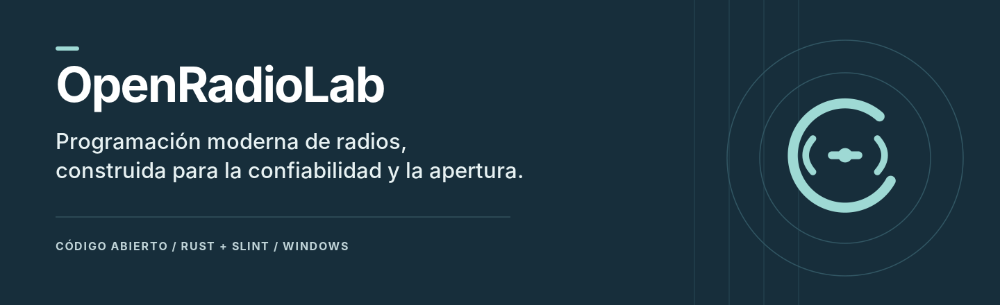

<div align="center">
  

  <h1>OpenRadioLab</h1>
  <p><strong>Tu radio. Tus canales. Tu laboratorio.</strong></p>

  <a href="https://github.com/danieliiisimo22-bit/OpenRadioLab/actions/workflows/ci.yml"></a>
  <a href="LICENSE"></a>

  <p><a href="README.md">English</a> · <a href="#empieza-aquí">Primeros pasos</a> · <a href="docs/compatibility.md">Compatibilidad</a> · <a href="CONTRIBUTING.md">Colaborar</a></p>
</div>

**Lee tu radio, edita tus canales y guarda los cambios en el equipo.** OpenRadioLab es una aplicación de escritorio gratuita y de código abierto, hecha con Rust y Slint. Reúne la edición de canales, los archivos de configuración y la programación directa en un mismo espacio de trabajo.

Probada en **Windows x86-64 con Kenwood TK-2402K**. La versión **0.6.0** sigue en desarrollo.

## Del cable a los canales

| Lee | Edita | Programa |
| --- | --- | --- |
| Elige el puerto y carga la configuración directamente desde la radio. No necesitas abrir un DAT primero. | Trabaja con 16 posiciones de canal, RX/TX independientes y tonos QT de recepción y transmisión. | Respalda la configuración actual, escribe los cambios admitidos y comprueba una lectura completa. |

## Qué puedes hacer

- **Trabajar con una radio real.** Identifica, lee y programa el modelo compatible mediante un cable USB de programación.
- **Ordenar tus configuraciones.** Abre y guarda DAT, o intercambia configuraciones como JSON y CSV.
- **Editar con margen para volver atrás.** Deshacer, rehacer, recuperación automática y conservación de campos binarios desconocidos.
- **Explorar desde la consola.** Inspecciona archivos, compara imágenes binarias, exporta configuraciones y lee la radio con la CLI.

El editor DAT admite cambios en frecuencias RX/TX de canales activos, tonos QT a QT, potencia, ancho de banda y Scan Add del canal 1. Todavía faltan los cambios binarios None/DQT, crear o eliminar canales y las demás posiciones de escaneo. El selector muestra más tonos de los que el escritor DAT admite actualmente; los cambios no implementados se rechazan. Consulta el [alcance comprobado](docs/compatibility.md).

## Empieza aquí

Instala **Rust 1.99+** y el compilador nativo de tu plataforma. Después:

```sh
git clone https://github.com/danieliiisimo22-bit/OpenRadioLab.git
cd OpenRadioLab
cargo run --locked -p radio-app
```

La [guía de compilación](docs/build.md) explica los requisitos de Windows. Los paquetes publicados, cuando estén disponibles, estarán en [Releases](https://github.com/danieliiisimo22-bit/OpenRadioLab/releases).

Dentro de la aplicación:

1. **Conexión** → selecciona el puerto → **Leer configuración de la radio**.
2. **Canales** → edita un canal → **Aplicar canal**.
3. **Archivos → Guardar como…** para guardar un archivo, o vuelve a **Conexión** para escribir los cambios admitidos.

Cierra otras aplicaciones de programación antes de abrir el puerto. La interfaz está en español; la documentación técnica está principalmente en inglés.

## En el banco de pruebas

Se han probado la identificación, la lectura completa y la escritura de Scan Add del canal 1 con verificación automática de toda la imagen. También se reportaron cambios correctos en frecuencias RX/TX y QT Encode/Decode sobre hardware real. Las [notas de validación](docs/compatibility.md) explican qué comprobó cada prueba.

Lo próximo: más campos DAT, fotos reales del proyecto y un video de programación. Cada perfil adicional necesitará sus propias pruebas. Linux y macOS siguen pendientes de validación.

## Explora el laboratorio

| Si buscas… | Empieza por aquí |
| --- | --- |
| Una guía de uso en español | [Guía rápida](docs/quickstart.es.md) |
| Compilar y ejecutar las comprobaciones | [Compilación](docs/build.md) |
| Ejemplos de consola y detalles técnicos | [Referencia técnica](docs/technical-overview.md) |
| Entender los módulos del proyecto | [Arquitectura](docs/architecture.md) |
| Conocer los formatos y comandos | [Formato DAT](docs/dat-format.md) · [Protocolo](docs/protocol-tk2402.md) |
| Ver los porcentajes de lenguajes y su método | [Composición del código](docs/source-languages.md) |

## Súmate

¿Encontraste un error, probaste una configuración o identificaste un campo nuevo? [Abre un issue](https://github.com/danieliiisimo22-bit/OpenRadioLab/issues) o consulta la [guía para colaborar](CONTRIBUTING.md). Los reportes reproducibles y las pruebas con hardware ayudan a avanzar.

---

[GPL-3.0-only](LICENSE) · [Avisos de terceros](THIRD_PARTY.md) · [Procedencia del desarrollo](docs/provenance.md)

OpenRadioLab es un proyecto independiente. Las marcas y los modelos indican compatibilidad, sin implicar afiliación ni respaldo del fabricante.
