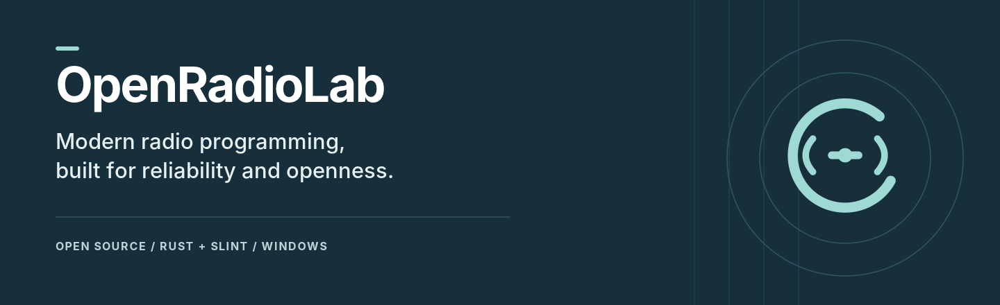

<div align="center">
  

  <h1>OpenRadioLab</h1>
  <p><strong>Your radio. Your channels. Your lab.</strong></p>

  <a href="https://github.com/danieliiisimo22-bit/OpenRadioLab/actions/workflows/ci.yml"></a>
  <a href="LICENSE"></a>

  <p><a href="README.es.md">Español</a> · <a href="#get-started">Get started</a> · <a href="docs/compatibility.md">Compatibility</a> · <a href="CONTRIBUTING.md">Contribute</a></p>
</div>

**Read your radio, edit your channels and write your changes back.** OpenRadioLab is a free, open-source desktop app built with Rust and Slint. It brings channel editing, file tools and direct radio programming into one native workspace.

Currently tested on **Windows x86-64 with the Kenwood TK-2402K**. Version **0.6.0** is a development preview.

## From cable to channels

| Read | Edit | Program |
| --- | --- | --- |
| Choose your serial port and load the radio directly. No DAT file needed first. | Work with 16 channel positions, separate RX/TX and QT Decode/Encode settings. | Back up the live configuration, apply supported changes and verify a complete readback. |

## What you can do

- **Work with real hardware.** Identify, read and program the supported radio over a USB programming cable.
- **Keep your files organized.** Open and save DAT files, or exchange configurations as JSON and CSV.
- **Edit with room to undo.** Undo/redo, recovery snapshots and preservation of unknown binary fields are built in.
- **Go deeper from the terminal.** Inspect files, compare binary images, export configurations and read a radio with the CLI.

The current DAT editor supports existing active RX/TX frequencies, QT-to-QT tone changes, power, bandwidth and Scan Add on channel 1. None/DQT binary edits, adding or removing channels and other scan positions are still pending. The UI can display more tone choices than the DAT writer currently supports; unsupported writes are rejected. See [compatibility and validation](docs/compatibility.md) for the exact scope.

## Get started

Install **Rust 1.99+** and the native compiler for your platform, then:

```sh
git clone https://github.com/danieliiisimo22-bit/OpenRadioLab.git
cd OpenRadioLab
cargo run --locked -p radio-app
```

See the [Windows build guide](docs/build.md) for compiler setup. Published packages, when available, belong in [Releases](https://github.com/danieliiisimo22-bit/OpenRadioLab/releases).

In the app:

1. **Conexión** → select your port → **Leer configuración de la radio**.
2. **Canales** → edit a channel → **Aplicar canal**.
3. **Archivos → Guardar como…** to save a file, or return to **Conexión** to write supported changes.

Close other radio programming applications before opening the port. The interface is currently in Spanish; English and Spanish project guides are available.

## On the bench

Hardware tests cover identification, a full read and a channel 1 Scan Add write with automatic full-image verification. RX/TX frequency and QT Encode/Decode changes have also been reported successful on hardware. The [validation notes](docs/compatibility.md) distinguish these results from software tests.

Next up: more DAT settings, real project photos and a programming video. Additional device profiles will need their own validation. Linux and macOS are not yet validated.

## Explore the lab

| Looking for… | Start here |
| --- | --- |
| A walkthrough in Spanish | [Quick start](docs/quickstart.es.md) |
| Build instructions and software checks | [Build guide](docs/build.md) |
| CLI examples and the full technical overview | [Technical overview](docs/technical-overview.md) |
| How the code fits together | [Architecture](docs/architecture.md) |
| File layouts and serial commands | [DAT format](docs/dat-format.md) · [Radio protocol](docs/protocol-tk2402.md) |

## Help build it

Found a bug, tested a setup or mapped a new field? [Open an issue](https://github.com/danieliiisimo22-bit/OpenRadioLab/issues) or read the [contribution guide](CONTRIBUTING.md). Useful hardware reports and clear reproduction steps help the lab grow.

<details>
<summary><strong>What's it built with?</strong></summary>

Rust handles the application and radio workflows; Slint defines the native interface. These measured shares include first-party code, tests and development scripts, by UTF-8 bytes.

<!-- source-languages:start -->

| Language | Files | Bytes | Lines | Share of source bytes |
| --- | ---: | ---: | ---: | ---: |
| Rust | 12 | 163007 | 4438 | 77.17% |
| Slint | 1 | 36759 | 844 | 17.40% |
| JavaScript | 3 | 9724 | 196 | 4.60% |
| PowerShell | 1 | 1524 | 47 | 0.72% |
| Shell | 1 | 210 | 8 | 0.10% |

<!-- source-languages:end -->

The [source inventory](docs/source-inventory.json) records every counted file and hash. Documentation, dependencies and generated files are excluded. [GitHub Linguist](https://docs.github.com/en/repositories/managing-your-repositorys-settings-and-features/customizing-your-repository/about-repository-languages) may classify the repository differently.

</details>

---

[GPL-3.0-only](LICENSE) · [Third-party notices](THIRD_PARTY.md) · [Development provenance](docs/provenance.md)

OpenRadioLab is an independent project. Manufacturer and model names identify compatibility; they do not imply affiliation or endorsement.
