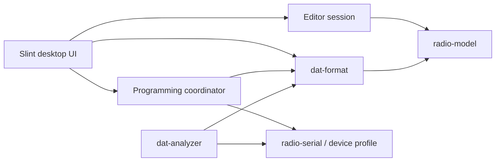

# Architecture

Open Radio Lab is a Cargo workspace. The UI coordinates work; device and format rules live in libraries.

## Libraries

`radio-model` defines frequencies as integer Hz, independent RX/TX signaling and validated configuration interchange. Unknown binary signaling remains an opaque word. A valid typed DCS code is not a claim about its binary device representation.

`dat-format` owns the original container and a decoded image. Parsing builds a typed view without discarding the underlying bytes. Serialization accepts only corroborated field changes; it rejects unsupported semantics and preserves the rest of the image.

`radio-serial` discovers ports and implements the current TK-2402 profile. `RadioSession` owns one port and its transport key. A write plan is immutable, limited to known offsets and tied to a full read from the same session.

## Application modules

| Module | Responsibility |
| --- | --- |
| `main.rs` | Window composition, callback binding and event-loop updates |
| `state.rs` | Current/saved configuration, history, recovery and exports |
| `file_dialog.rs` | Native path selection without performing saves |
| `signaling_choices.rs` | UI labels and typed signaling conversion |
| `programming.rs` | Backup, candidate creation, writing and reconnect/readback verification |

Hardware jobs run on worker threads. Slint weak handles post progress and completion back to the UI thread. While a transfer is active, conflicting actions and application close are blocked. No serial port opens merely because the UI starts or an input file is loaded.

## Write contract

1. Validate the requested typed configuration.
2. Identify the radio and read its complete live image.
3. Save and recheck the live backup on disk.
4. Serialize supported differences onto that live image, then persist the plan.
5. Send only changed 64-byte blocks and require acknowledgments.
6. Exit PC mode, close the port, and open a new session.
7. Read all 8192 bytes and compare them with the planned image.
8. Report success and update the editor only after an exact match and confirmed exit.

An error preserves the editor and available evidence. There is no automatic rollback or retry after an ambiguous write acknowledgment.

## Files and storage

`open-radio-lab-data/` next to the executable stores private backups, recovery snapshots, logs and serial evidence. `--data-dir PATH` selects another writable location. Export destinations use atomic no-clobber publication; existing files and originals are protected.

## Platform boundary

Model, format and transport code use portable Rust APIs. The current native file-dialog adapter is Windows-specific behind `cfg(windows)`. Linux/macOS dialogs and physical device support remain unvalidated; portability is a development goal, not a completed capability.

